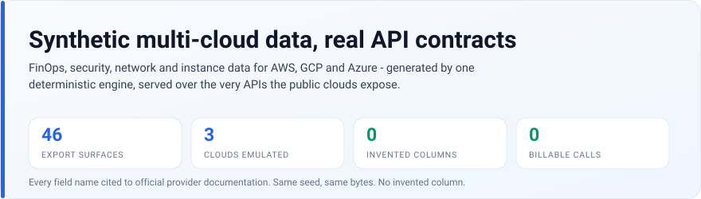
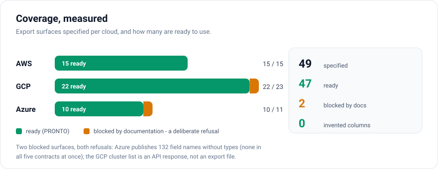
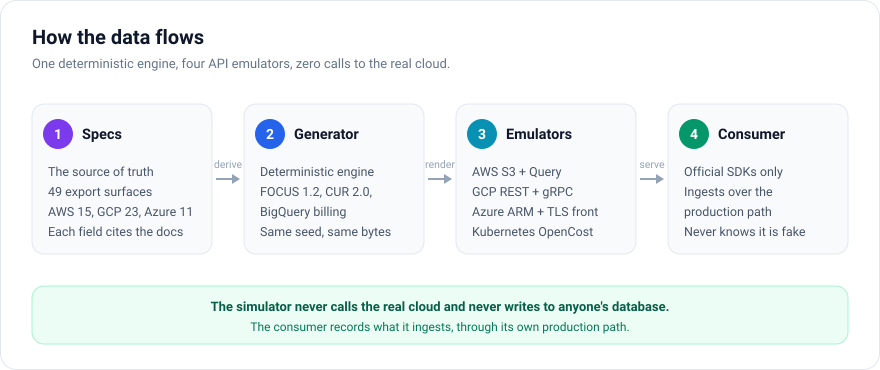
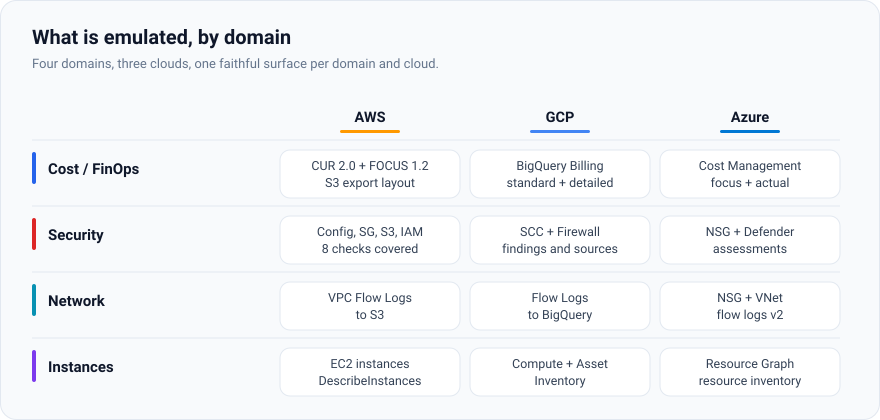

# Simulador  
# Gerador de nuvens sinteticas + emuladores de API

> Idioma: **Português** | [English](README.en.md)

Simulador multi-nuvem **independente**. Gera todos os dados necessarios —
FinOps, seguranca, rede e instancias — para **AWS, GCP e Azure**, e os entrega
seguindo o mecanismo e o formato de export que **cada nuvem realmente usa**.



O repositorio tem duas partes:

| Parte | Onde | O que e |
|---|---|---|
| **Gerador** | `tools/synthetic_clouds/` | Deriva os artefatos a partir das specs citadas; tem os gates de fidelidade. |
| **Emuladores** | `emulators/`, `deploy/`, `scripts/` | Servem os mesmos dados pelas APIs de cada nuvem (Query/S3 REST, ARM, GCP REST/gRPC). |

> Os numeros de "Estado atual" foram medidos em **2026-10-27**. A coluna "Como
> medir" diz exatamente qual comando reproduz cada um — se um numero divergir do
> codigo, o comando ganha do numero.

## Estado atual

| Metrica | Valor | Como medir |
|---|---|---|
| Superficies de export especificadas | **48** — AWS 15 · GCP 22 · Azure 11 | `specs/**/*.schema.json` |
| Superficies **PRONTO** | **47** | `fidelity --ready` → `PRONTO: 47`, exit 0 |
| Bloqueada pela documentacao | **1** — `azure/cost-management-export-cost-details` | `fidelity --matrix` → `bloqueado=1` |
| Falta gerar | **0** | `fidelity --matrix` → `falta=0` |
| Coluna inventada (qualquer provedor) | **0** | `fidelity --audit aws` → `com coluna inventada=0` |
| Testes | **1106 passam, 20 skip** (1126 coletados) | `pytest tools\synthetic_clouds\tests --collect-only -q` |
| Specs em prosa | **29** | `specs/<provedor>/*.md` |
| Emuladores | **3** — AWS · Azure · GCP | `emulators/` |
| Arquivos versionados | **445** | `git ls-files` |

> No disco sao **447** arquivos: os **445** versionados + `.publish-manifest.json`
> (artefato de build, fora do git) + `tools/synthetic_clouds/schedule/simulador-nuvem-daily.xml`
> (ignorado pelo `.gitignore`).

A unica superficie bloqueada e uma **recusa deliberada**, nao uma falta: a
Microsoft publica os 132 nomes sem tipos, e nenhum deles aparece nos cinco
contratos ao mesmo tempo. Gerar exigiria inventar tipo e escolher contrato —
exatamente o que a regra 3 abaixo proibe. O motivo esta registrado em
`docs/NAO-COMPROVADOS.md`.



## Regras inviolaveis

1. **Nada fora desta arvore.** O simulador e autonomo: nao escreve em nenhum
   banco, container ou repositorio de terceiros, e nunca fala com a nuvem real.
2. **Fidelidade aferida, nao presumida.** Todo nome de campo, tipo, unidade,
   formato de data, layout de path e tipo de arquivo vem de **documentacao
   oficial do provedor**, citada com URL e data de consulta.
3. **Nenhum campo inventado.** O que nao estiver documentado e marcado como
   `UNVERIFIED` e permanece fora da geracao ate ser comprovado. Nao existe
   "parece razoavel" neste projeto.
4. **Nada de credencial ou chamada faturavel.** O simulador nunca fala com a
   nuvem real. O `aws-sim` ainda recusa subir se detectar material de
   credencial real no ambiente (`emulators/aws-sim/aws_sim/guard.py`).

## Layout

| Caminho | Papel |
|---|---|
| `specs/` | Especificacoes de export por nuvem, com citacao da doc oficial. **Fonte da verdade.** |
| `specs/<cloud>/*.schema.json` | Inventario de campos legivel por maquina, derivado da spec e usado pelos testes de fidelidade. |
| `specs/_tools/` | Utilitarios de auditoria versionados (procedencia, colunas por spec, URLs, gerador do registro de nao-comprovados). |
| `tools/synthetic_clouds/` | O gerador, com o motor de fidelidade e a suite de testes. |
| `docs/` | Notas de metodo, decisoes e auditorias. |
| `emulators/aws-sim/` | Emulador AWS (Query + S3 REST) + `Containerfile`. |
| `emulators/azure-sim/` | Emulador Azure (ARM + exportador de custo) + `Containerfile`. |
| `emulators/gcp-sim/` | Emulador GCP (REST + gRPC de monitoring) + `Dockerfile`. |
| `deploy/synthetic-clouds/` | Composes e `.env.example` da pilha. |
| `scripts/synthetic-clouds/` | Orquestracao (`up`, `down`, `smoke`, `seed`, `export_once`). |

O caminho `tools/synthetic_clouds` e deliberado: o codigo se auto-importa como
`tools.synthetic_clouds` em 281 pontos, e move-lo exigiria uma renomeacao em
massa sem ganho. A configuracao de `ruff`/`mypy`/`pytest` do pacote esta em
`tools/synthetic_clouds/pyproject.toml` — **nao** crie config na raiz.

## Metodo

O trabalho avanca nesta ordem, sempre:

1. **Especificar** — levantar o formato oficial em `specs/`, com citacao.
2. **Gerar** — implementar o renderer a partir da spec, nunca a partir de memoria.
3. **Provar** — teste de fidelidade que compara o artefato gerado contra
   `specs/<cloud>/*.schema.json`: conjunto de colunas exato, ordem,
   unidades e formatos.

Uma superficie de export so e considerada pronta quando os tres passos fecham.

## Arquitetura



O caminho e sempre o mesmo: a **spec** e a fonte da verdade, o **gerador** e
deterministico, os **emuladores** servem o mesmo dado pelas APIs de cada nuvem,
e o **consumidor** ingere pelo proprio caminho de producao. O simulador nao
fala com a nuvem real em momento algum.

## O que e emulado



Quatro dominios — custo/FinOps, seguranca, rede e instancias — nas tres
nuvens. Cada celula corresponde a superficies de export com spec, gerador e
teste de fidelidade proprios.

## Ambiente

```powershell
# interpretador proprio do projeto (CPython 3.12)
& "C:\Users\ECUNHA\AppData\Local\Programs\Python\Python312\python.exe" -m venv .venv
& .\.venv\Scripts\python.exe -m pip install -U pip
& .\.venv\Scripts\python.exe -m pip install pandas pyarrow pydantic structlog pytest ruff mypy
```

`python -m tools...` acha o pacote pelo proprio CWD e **nao** precisa de
`PYTHONPATH`; so os scripts executados por caminho (`specs\_tools\*.py`) precisam
— e esses ja inserem a raiz no `sys.path` sozinhos.

### Verificacao do gerador

```powershell
# contrato das specs e estado de prontidao (exit != 0 enquanto houver problema)
& .\.venv\Scripts\python.exe -m tools.synthetic_clouds.fidelity --ready
& .\.venv\Scripts\python.exe -m tools.synthetic_clouds.fidelity --matrix   # gerado / falta / bloqueado
& .\.venv\Scripts\python.exe -m tools.synthetic_clouds.fidelity --audit aws # colunas inventadas

# lint e tipo usam a configuracao de registro do pacote: SEMPRE com --config
& .\.venv\Scripts\ruff.exe check tools\synthetic_clouds --config tools\synthetic_clouds\pyproject.toml
& .\.venv\Scripts\mypy.exe -p tools.synthetic_clouds --config-file tools\synthetic_clouds\pyproject.toml
& .\.venv\Scripts\python.exe -m pytest tools\synthetic_clouds\tests -q
```

**A suite e `pytest tools\synthetic_clouds\tests`.** O `mypy` e `-p`, nao
caminho: `mypy tools\synthetic_clouds` falha com *"Source file found twice under
different module names"* e **nao checa nada**.

### Os 20 skips da suite sao decisions, nao falhas

Dez deles vem da fixture `real_parser`, que carrega o parser CUR da plataforma
**consumidora** para conferir o round-trip do FOCUS. Essa plataforma nao faz
parte deste repositorio, entao a fixture **skipa** quando ele nao esta
presente (o guard e `pytest.skip`, nao erro). Os outros dez sao a suite
`integration`, que exige banco.

## Emuladores

A pilha sobe com `podman compose`, a partir de `deploy/synthetic-clouds/`:

```powershell
cd deploy\synthetic-clouds
Copy-Item .env.example .env      # ajuste as portas se preciso
..\..\scripts\synthetic-clouds\up.ps1
```

Os tres emuladores respondem em `localhost`:

| Emulador | Porta | Health |
|---|---|---|
| `aws-sim` | 8086 | `GET /healthz` |
| `azure-sim` | 8080 | `GET /healthz` |
| `gcp-sim` | 8085 (REST) · 8087 (gRPC) | `GET /healthz` |

O `gcp-sim` precisa dos *fixtures* renderizados para responder; o
`gcp-smoke.ps1` faz o ciclo inteiro (render → provision → leitura).

### Como as imagens sao construidas

O **contexto de build** e a raiz deste repositorio, e cada `Containerfile`
copia **apenas** o que precisa:

```dockerfile
COPY tools/synthetic_clouds      /app/tools/synthetic_clouds
COPY emulators/aws-sim           /app/emulators/aws-sim
```

O gerador entra na imagem como namespace `tools.synthetic_clouds.*`, resolvido
por `PYTHONPATH=/app` — nunca como wheel instalado. Nenhum outro diretorio
participa do build.

## Onde ler mais

| Documento | Para que |
|---|---|
| [`AGENTS.md`](AGENTS.md) | Contrato operacional para agentes: como rodar, o que nunca editar a mao, o que fazer quando a evidencia nao existe. |
| [`specs/README.md`](specs/README.md) | O contrato que cada spec `.md` e cada `*.schema.json` precisa cumprir. |
| [`docs/ESTADO.md`](docs/ESTADO.md) | Estado do simulador: o que esta pronto, o que esta bloqueado e por que. |
| [`docs/POSTURA-SEGURANCA.md`](docs/POSTURA-SEGURANCA.md) | Os checks de seguranca do gerador e dos emuladores. |
| [`tools/synthetic_clouds/README.md`](tools/synthetic_clouds/README.md) | O gerador em detalhe: estrutura, metodo e armadilhas conhecidas. |
